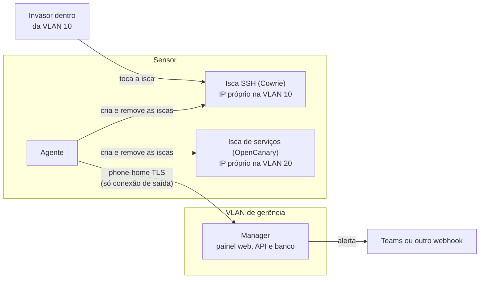

# Mellyx

> Plataforma web leve, hospedada na própria infraestrutura, para implantar, monitorar e receber alertas de **iscas (honeypots) dentro dos segmentos da rede interna**, detectando movimentação lateral que o firewall não vê.


> [!NOTE]
> **Ainda não há código.** O projeto está na fase de planejamento: requisitos, regras de negócio, casos de uso, arquitetura e cronograma estão definidos. A construção começa com a prova de conceito (I0) em dezembro de 2026. O andamento fica no [Project do repositório](https://github.com/users/zLuuuck/projects/2).

---

## O problema

Quando um invasor entra na rede de uma empresa, quase sempre com uma senha roubada, ele leva poucas horas para chegar ao servidor que controla todos os acessos: a mediana até o Active Directory foi de **3,4 horas** em 2025 ([Sophos, Active Adversary Report 2026](https://www.helpnetsecurity.com/2026/02/27/sophos-identity-driven-breaches-report/)). A empresa leva bem mais tempo para perceber: o tempo mediano de permanência do invasor chegou a **14 dias**, e em casos de ransomware o próprio criminoso avisou a vítima em **44%** das vezes ([Mandiant, M-Trends 2026](https://cloud.google.com/security/resources/m-trends-executive-edition)).

A segmentação por VLAN e firewall protege o tráfego **entre** segmentos. O tráfego **dentro** de um mesmo segmento é comutado pelo switch e não passa pelo firewall. É por ali que o invasor se move, e quase nada o detecta.

Empresas grandes compram iscas comerciais para notar esse invasor cedo, com contrato mediano de cerca de **US$ 9.900 por ano** ([Vendr, Thinkst Canary](https://vendr.com/marketplace/thinkst-canary)). Empresas pequenas e médias, que têm firewall e VLAN mas ninguém olhando a rede o tempo todo, ficam sem nada.

## A ideia

A resposta óbvia é vigiar tudo: antivírus avançado, análise de tráfego, SIEM. Funciona, mas é caro, gera muito alerta e exige alguém olhando o tempo todo.

O Mellyx faz o contrário: **não procura a agulha no palheiro, espalha agulhas falsas.** Iscas que se passam por máquinas reais são colocadas dentro dos segmentos. Nenhum uso legítimo tem motivo para tocar nelas, então **qualquer toque já é um alerta de alta confiança**, sem a avalanche de falsos positivos.

O Mellyx **não constrói o motor da isca**. Ele reutiliza projetos consolidados ([Cowrie](https://github.com/cowrie/cowrie) e [OpenCanary](https://github.com/thinkst/opencanary)) e é a **camada de gestão**: orquestração, implantação, coleta, normalização, classificação e alerta.

---

## Como funciona



1. **Manager:** aplicação web central. O administrador cadastra os segmentos, registra o sensor com um comando único e escolhe onde implantar cada isca.
2. **Agente:** roda no sensor, busca no manager o estado desejado e cria ou remove as iscas até a rede ficar igual ao que foi pedido. Também coleta os eventos e os envia em lotes.
3. **Iscas:** containers do Cowrie e do OpenCanary, cada um com **endereço próprio dentro do segmento**, aparecendo na rede como mais uma máquina.
4. **Alerta:** o manager normaliza o evento, classifica (varredura ou tentativa de exploração), mapeia para técnicas do [MITRE ATT&CK](https://attack.mitre.org/) e dispara o alerta.

**Modelo phone-home:** o manager nunca acessa as VLANs. É o agente que inicia a conexão de saída, cifrada com TLS, então basta uma regra de saída no firewall, só para o manager.

## O que o Mellyx promete e o que não promete

| Promete | Não promete |
|---|---|
| Alerta de alta confiança quando alguém toca uma isca | Ver movimento entre duas máquinas reais que nunca tocam a isca (é detecção por armadilha, não inspeção de tráfego) |
| Captura de usuário, senha e comandos tentados na isca SSH (Cowrie, média interação) | Enganar um atacante avançado que identifique a emulação |
| Implantação pela interface, sem editar arquivos | Substituir firewall, antivírus ou EDR: é uma camada complementar |
| Iscas emuladas, sem nenhum sistema real exposto | Detectar toda varredura (varreduras que não completam a conexão são uma limitação medida e declarada) |

---

## Trabalhos relacionados

| Projeto | O que é | Diferença para o Mellyx |
|---|---|---|
| [HoneyWire](https://github.com/andreicscs/HoneyWire) (2026) | Plataforma aberta de armadilhas para rede interna, com painel central. **É o trabalho mais próximo** | Iscas próprias de baixa interação, na rede da própria máquina. O Mellyx posiciona cada isca no segmento com endereço próprio e usa o Cowrie, de média interação |
| [Thinkst Canary](https://canary.tools/) | Iscas comerciais | Pago e fechado |
| [OpenCanary](https://github.com/thinkst/opencanary) | Motor de isca aberto | Sem gestão central; o Mellyx o usa como motor |
| [T-Pot](https://github.com/telekom-security/tpotce) | Coleção de honeypots para pesquisa na internet | Foco externo e requisitos altos (8 a 16 GB) |
| [MHN](https://github.com/pwnlandia/mhn) | Gestão centralizada de honeypots | Foco em inteligência de ameaças externas; sem atividade recente |

A proposta do Mellyx foi registrada neste repositório em **12/06/2026**, de forma independente do HoneyWire, que foi identificado durante a revisão de trabalhos relacionados em novembro de 2026. Ideias que se conectam, vindas de lugares diferentes do mundo, mostram que o problema é real.

---

## Stack prevista

| Parte | Tecnologia | Situação |
|---|---|---|
| Backend do manager | Python, Flask, Gunicorn, SQLAlchemy, Alembic | Definida (Flask ou FastAPI decidido no início do I1) |
| Frontend | React, TypeScript, Vite, Tailwind CSS, Recharts | Definida |
| Banco de dados | PostgreSQL | Definida |
| Agente do sensor | **Go**, binário estático, SDK oficial do Docker | A confirmar na prova de conceito; se não fechar, volta para Python |
| Iscas | Docker com rede macvlan, Cowrie, OpenCanary | Definida |
| Alertas | Webhook HTTP com modelo pronto para o Workflows do Teams | Definida |

## Roteiro

| Marco | Entrega | Previsão |
|---|---|---|
| I0, prova de conceito (M1) | Laboratório com VLANs, agente mínimo criando uma isca Cowrie na VLAN, evento chegando numa API | Dezembro de 2026 |
| Projeto Lógico | Requisitos, casos de uso, UML, banco de dados e plano de testes | Dezembro de 2026 a janeiro de 2027 |
| I1 a I4, MVP (M2) | Registro de sensor, implantação de iscas, eventos, classificação e alertas | Meta: 31/01/2027 |
| I5 e I6 | Painel completo, segundo motor de isca, auditoria, endurecimento e manual | Primeiro semestre de 2027 |
| Validação (M3) | Experimentos em laboratório, incluindo comparação com o HoneyWire | Primeiro semestre de 2027 |
| Defesa (M4) | Monografia e banca | Meados de 2027 |

## Estrutura do repositório (planejada)

```
mellyx/
├── backend/     # API do manager (Python)
├── frontend/    # painel web (React)
├── agent/       # agente do sensor
├── database/    # migrações e dados iniciais
├── docs/        # requisitos, regras de negócio, casos de uso, DER, arquitetura, testes, ADRs
└── assets/      # imagens do README
```

---

## Contexto acadêmico

Trabalho de Conclusão de Curso de **Análise e Desenvolvimento de Sistemas** da **Universidade Tuiuti do Paraná (UTP)**, desenvolvido de forma iterativa e incremental com Kanban. A documentação de entrega segue o formato de Projeto Lógico da disciplina de Projeto e Desenvolvimento de Sistemas.

O nome **Mellyx** vem de *mel* e *mellis* (mel, em latim), em referência a *honeypot*.

## Uso de inteligência artificial

Ferramentas de IA podem apoiar partes repetitivas do desenvolvimento (componentes de interface, código de infraestrutura, testes e revisão de texto). As decisões de arquitetura e de segurança, os registros de decisão (ADRs) e as análises do trabalho são do autor, e todo código que entra no repositório é revisado e explicável por ele. O uso será declarado na monografia.

## Aviso de uso

O Mellyx é uma ferramenta **defensiva**, voltada à **detecção** de atividade não autorizada. As iscas são **emuladas** (baixa ou média interação) e não expõem sistemas reais. O uso em qualquer rede de produção exige autorização formal e prévia dos responsáveis. Os eventos podem conter dados pessoais (como usuários e senhas digitados), que são tratados com mascaramento e acesso restrito, em conformidade com a LGPD.

## Licença

[MIT License](./LICENSE). Componentes de terceiros (Cowrie e OpenCanary) e seus avisos de copyright estão em [Third_party_licenses.md](./Third_party_licenses.md).

## Autor

Desenvolvido por [@zLuuuck](https://github.com/zLuuuck) (Lucas Toterol) como Trabalho de Conclusão de Curso de Análise e Desenvolvimento de Sistemas (UTP).
