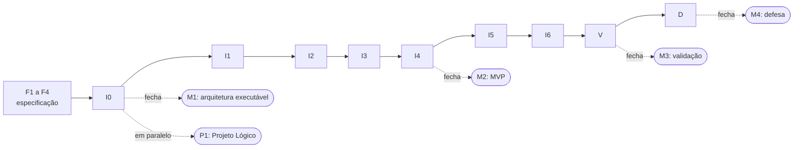
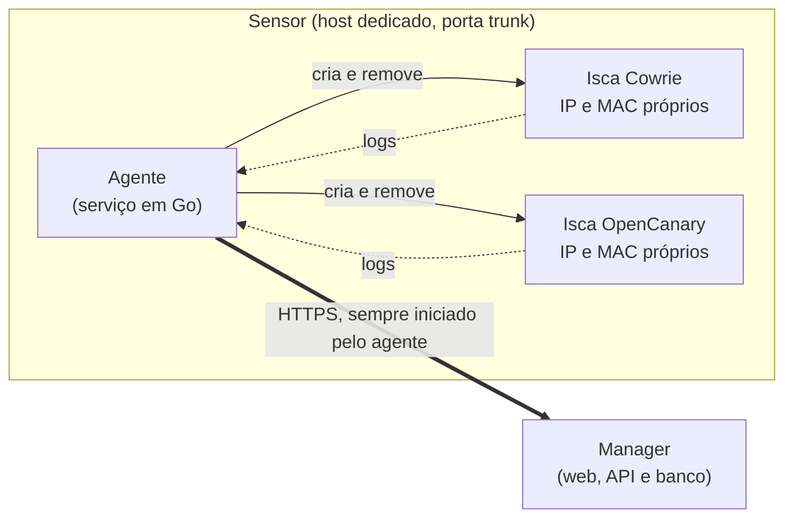

# Legenda do planejamento do Mellyx

Neste documento explico os códigos que uso nas issues, nos milestones e no quadro do GitHub Projects do Mellyx. Ele provavelmente vai mudar, e talvez eu o divida em documentos menores (um `.md` por assunto).

## Como organizo o trabalho

O Mellyx é o meu TCC de Análise e Desenvolvimento de Sistemas (UTP). Fiz a especificação primeiro, de forma sequencial (fases F1 a F4). A construção é **iterativa e incremental, com fluxo Kanban** (incrementos I0 a I6). Os marcos (M e P) são datas de controle.

### Este planejamento não é fixo

As tarefas que estão aqui são as que consigo enxergar hoje. Novas tarefas vão surgir durante o desenvolvimento, e algumas podem mudar de grupo ou ser cortadas pela regra de corte. Quando uma tarefa nova aparece, abro uma issue com o template de tarefa, no grupo em que ela se encaixa, com as horas planejadas, e registro o motivo na revisão do grupo.

## Códigos de agrupamento (viram milestones)

| Código | Nome | O que é |
|---|---|---|
| **F1** | Gerência do projeto | Cronograma, escopo, riscos, acompanhamento com a orientação e regulamento. Vai do início ao fim. |
| **F2** | Fundamentação teórica | Estudo de deception e honeypots, dos motores que reutilizo (Cowrie e OpenCanary), das soluções existentes e dos trabalhos relacionados. |
| **F3** | Análise e requisitos | Cenário, lacuna, atores, requisitos, regras de negócio, casos de uso e delimitação do MVP. |
| **F4** | Arquitetura e projeto | Arquitetura cliente e servidor, componentes, modelo de dados, UML, stack, contrato da API e protótipo de telas. |
| **I0** a **I6** | Incrementos | Fatias verticais de construção. Cada incremento termina com algo que consigo demonstrar no laboratório. |
| **V** | Validação | Testes funcionais (T) e experimentos de avaliação (E) no laboratório segmentado. |
| **D** | Documentação e defesa | Projeto Lógico (entrega parcial da disciplina), texto final da monografia, slides, demo e ensaio da banca. |

### Incrementos

| Incremento | Saída demonstrável |
|---|---|
| **I0** PoC e laboratório | Prova de conceito do agente e respostas dos bloqueadores técnicos (B) registradas em ADRs |
| **I1** Manager base e enrollment | O sensor aparece ONLINE na interface |
| **I2** Deploy por estado desejado | A isca criada pela interface responde na VLAN |
| **I3** Eventos e classificação | Um ataque do Kali aparece classificado na interface |
| **I4** Alertas | O alerta chega no Teams; fecha o MVP |
| **I5** OpenCanary, painel e auditoria | Painel completo |
| **I6** Endurecimento e manual | Sistema pronto para a validação |

## Marcos

| Código | Fase de controle | Critério | Previsão |
|---|---|---|---|
| **M0** | Concepção | Tema aprovado, escopo e riscos registrados | Parcialmente concluído (nov/2026); falta a aprovação formal |
| **M1** | Elaboração | Arquitetura executável: isca em macvlan, evento numa API mínima e bloqueadores respondidos | Fim do I0 |
| **P1** | Elaboração (documento) | Projeto Lógico entregue na disciplina de Projeto e Desenvolvimento de Sistemas | Data da disciplina |
| **M2** | Construção | MVP ponta a ponta: enrollment, implantação pela interface, evento classificado e alerta no Teams | Fim do I4 (meta: 31/01/2027) |
| **M3** | Transição | I5 e I6 entregues ou cortados; validação executada | Meio do 5º semestre |
| **M4** | Defesa | Monografia entregue e demo ensaiada | Data oficial da UTP |

Uso as fases de concepção, elaboração, construção e transição só como datas de controle.

**Regra de corte:** se o M2 não estiver pronto até 31/01/2027, o I5 se reduz ao normalizador do OpenCanary e o painel mostra contagens sem gráfico. Se sobrar tempo, eu invisto em qualidade, nunca em escopo novo.

## Horas

As horas planejadas em cada issue são **estimativas minhas**, feitas com o que sei hoje, e podem sair maiores. Por isso cada issue registra as **horas planejadas** e as **horas reais**, e a diferença entre as duas faz parte da avaliação do próprio planejamento.

## Códigos de rastreabilidade (aparecem no corpo das issues)

| Código | Significado | Exemplo |
|---|---|---|
| **RF** | Requisito funcional: o que o sistema faz | RF05: registrar o sensor a partir do token |
| **RNF** | Requisito não funcional: qualidade exigida, classificada pelo FURPS+ (abaixo) | RNF10: evento no painel em até 10 s |
| **RN** | Regra de negócio: restrição que o sistema impõe | RN04: token de enrollment de uso único, que expira em 24 h |
| **UC** | Caso de uso: interação de um ator com o sistema | UC08: implantar honeypot |
| **B** | Bloqueador técnico que a PoC (I0) precisava responder antes do código de produção | B3: como o Cowrie escuta na porta 22 dentro da macvlan |
| **ADR** | Architecture Decision Record: registro curto de uma decisão técnica e do seu motivo | ADR do B9: agente em Go |
| **T** | Teste funcional, com resultado esperado × obtido | T06: força bruta SSH gera alerta em até 30 s |
| **E** | Experimento de avaliação, que mede a contribuição do Mellyx | E3: esforço de implantação manual × Mellyx |

### Classificação dos RNF (FURPS+)

Classifico os requisitos não funcionais pelas categorias do FURPS+, como apresentadas por Larman (Grady, 1992 apud Larman, 2001, p. 42 e 43):

| Letra | Categoria | RNF do Mellyx |
|---|---|---|
| **F** | Funcionalidade (inclui segurança) | RNF02 (comunicação iniciada pelo agente, com TLS), RNF03 (iscas só emuladas e sem privilégio), RNF09 (segurança da aplicação) |
| **U** | Usabilidade (fatores humanos, ajuda e documentação) | RNF12 (implantar em até 5 passos), RNF13 (acessibilidade) |
| **R** | Confiabilidade (frequência de falha, recuperação) | RNF11 (buffer local e reenvio sem duplicar) |
| **P** | Desempenho (tempo de resposta, uso de recursos) | RNF07 (leveza), RNF10 (tempo até o painel e até o alerta) |
| **S** | Suportabilidade (adaptabilidade, manutenção, configuração) | RNF01 (navegador moderno), RNF08 (não depende do fabricante do firewall) |
| **+** | Implementação, interface, operação, empacotamento e legal | RNF04 (empacotamento), RNF05 e RNF06 (implementação), RNF14 (operação sem internet), RNF de proteção de dados pessoais (legal, LGPD) |

## Componentes do Mellyx

O Mellyx segue uma arquitetura **cliente e servidor**: o agente é o cliente e o manager é o servidor. Quem inicia a conexão é sempre o agente, então o sensor não precisa abrir nenhuma porta, e a segmentação só precisa liberar uma regra de saída, de cada segmento para o manager.

| Termo | O que é |
|---|---|
| **Manager** | O servidor: interface web, API e banco de dados. Guarda a configuração, o estado desejado, os eventos e os alertas. Nunca abre conexão com o sensor. |
| **Sensor** | O **host** (máquina física ou VM) dedicado ao Mellyx, ligado em porta trunk às VLANs monitoradas. É onde rodam o agente e as iscas. Pode ser a mesma máquina do manager. |
| **Agente** | O cliente: um **serviço** em Go que roda no sensor como serviço do sistema. É a única ponte entre o que existe no sensor e o manager. Ele busca o estado desejado, cria e remove as iscas pelo Docker, lê os logs delas e envia os eventos. As iscas nunca falam com o manager diretamente. |
| **Isca (instância)** | Um honeypot em container (Cowrie ou OpenCanary) com IP e MAC próprios na VLAN, que para a rede parece um host comum. |
| **Estado desejado** | O manager registra o que deve existir (quais iscas, em qual VLAN e com qual IP), e o agente compara com o que existe no sensor e corrige a diferença. Chamo essa comparação de reconciliação. |
| **MVP** | Produto mínimo viável: o que precisa estar pronto para a banca (fecha no M2). |
| **PoC** | Prova de conceito: código descartável que testou a viabilidade técnica (I0, 20/11/2026). |

## Labels

| Label | Uso |
|---|---|
| `prioridade: crítica` | Caminho crítico do MVP: se atrasar, empurra o M2 |
| `prioridade: importante` | Entra no MVP, mas tem folga |
| `prioridade: desejável` | A primeira a sair pela regra de corte |
| `risco` | Risco técnico ou de prazo conhecido |
| `bloqueado` | Depende de algo externo (regulamento, data da UTP, resposta de terceiros) |
| `rascunho: validar` | Rascunho feito; falta validar ou passar a limpo |
| `epic` | Issue pai de um grupo (F1 a F4, I0 a I6, V, D) |
| `agente`, `api`, `frontend`, `banco`, `lab`, `ci`, `docs`, `pesquisa`, `gestao` | Área do trabalho |
| `adr`, `teste` | Tipo de entrega |

Uma issue pode ter, e vai ter, várias labels: por exemplo, uma de prioridade, uma de área e, quando couber, `risco`.

## Quadro Kanban

Separo o trabalho nestas colunas: Backlog > Pronto para fazer > Fazendo (no máximo 2 itens, como referência e não como regra) > Revisão e teste > Feito.

**Definição de pronto de um incremento:** o fluxo funciona no laboratório e pode ser demonstrado; as regras determinísticas tocadas têm teste automatizado passando na CI; a migração do banco está aplicada e versionada; os endpoints novos estão descritos no contrato da API.

## Referências

LARMAN, Craig. *Applying UML and Patterns*: an introduction to object-oriented analysis and design and the unified process. 2. ed. Upper Saddle River: Prentice Hall PTR, 2001.
